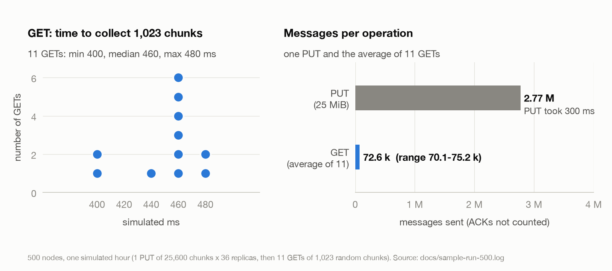
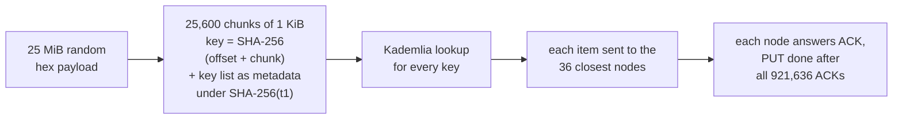
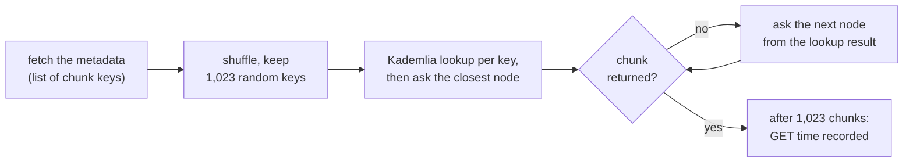

# Blockchain scalability with data availability sampling over Kademlia

BSc dissertation project, Lancaster University, 2025. It simulates DAS-style chunked storage and random-sampling retrieval over a Kademlia network in [PeerSim](http://peersim.sourceforge.net/).

Author: Damire Zalyatov

> **This is a fork of [datahop/kademlia-simulator](https://github.com/datahop/kademlia-simulator)**, a Kademlia simulator built on PeerSim from the Kademlia implementation of Daniele Furlan and Maurizio Bonani. The base is upstream commit [`2ef9f79`](https://github.com/datahop/kademlia-simulator/commit/2ef9f79279af3de1673966b492cdc4eedd7cbe3b) (branch `put_get`). All other source files are theirs, unchanged. The dissertation work is on the **`das-sampling`** branch only ([diff against the base](https://github.com/DominicDamire/das-kademlia-simulator/compare/2ef9f79279af3de1673966b492cdc4eedd7cbe3b...das-sampling)); the other branches are copies of upstream branches that every GitHub fork inherits.



*One 500-node run (1 PUT, then 11 GETs). Left: GET latency in simulated milliseconds. Right: messages sent by the PUT and by an average GET. Console output: [`docs/sample-run-500.log`](docs/sample-run-500.log) (one key hash is shortened, because secret scanners mistake it for a key). The chart is drawn by [`docs/plot_results.py`](docs/plot_results.py) (needs matplotlib).*

## How it works

**PUT: store one 25 MiB value**



**GET: sample the stored value**



An unanswered request triggers a ping, and a peer that does not answer is removed from the routing table.

## What Damir added

The Kademlia routing and lookup, the put/get operations, churn, transport delays and the observer framework are upstream code that Damir configured. His additions are in `simulator/src/main/java/peersim/kademlia/`, `simulator/config/kademlia_putget.cfg` and `simulator/run.sh`:

- **Chunking.** A 25 MiB value (26,214,400 random hex characters, generated in `TrafficGeneratorPutGet`) is cut into 25,600 chunks of 1 KiB. Each chunk is keyed by the SHA-256 of its 4-byte offset and its bytes. The list of all chunk keys is stored as metadata under SHA-256("t1").
- **PUT.** Every chunk is stored on the 36 closest nodes found by an iterative Kademlia lookup. Each node answers with an ACK, and the PUT time is recorded when all 921,636 ACKs ((25,600 chunks + 1 metadata object) x 36) have arrived.
- **GET (sampling).** A node fetches the metadata, shuffles the chunk keys and looks up 1,023 random chunks (about 4%). If a node has no chunk, it asks the next node from the lookup result. The GET time is recorded when 1,023 chunks have arrived.
- **Liveness.** An unanswered request triggers a ping (`MSG_EMPTY`); a peer that does not answer with a `MSG_PONG` is removed from the routing table. This implements the timeout handler that upstream left commented out.
- **Metrics.** GET, PUT and FIND timing stores, a `reset()` for them, and a new observer line (HOP, GET and PUT averages; FIND min, max and average).
- **Upstream bug fix.** `KademliaObserver.writeMap` wrote an empty first column and dropped the last character of each CSV row. Fixed.
- **Defaults and config.** K 16 to 36, MAXREPLACEMENT 10 to 20, FINDMODE 1 to 0. `kademlia_putget.cfg` is his saved config: 25,000 nodes, one simulated hour, a PUT at t=0 and a GET every 300 s, churn (`p_idle` 0.33, `p_add` 0.33, `p_rem` 0.34), a fixed 10 ms link delay, 256-bit ids. `run.sh` sets a 16 GB heap.

Changed files: `KademliaProtocol`, `KademliaObserver`, `TrafficGeneratorPutGet`, `Util` (`SHA256(byte[])`), `GetOperation`, `Message` (three new message types), `Timeout`, `KademliaCommonConfig`. Malicious-node support (`isEvil`) exists upstream but is not used.

## Results

500 nodes (499-505 up during the run, because of churn), one simulated hour:

| | PUT (1 run) | GET (11 runs) |
|---|---|---|
| Work | 25,600 chunks + 1 metadata object, 36 replicas each | 1,023 random chunks |
| Simulated time to complete | 300 ms | 400-480 ms (median 460) |
| Messages sent (ACKs not counted) | 2.77 M | 70-75 k (average 72.6 k) |

Wall time was 84-177 s on an Apple-silicon Mac (the slower run had other jobs running), with about 3.8 GB peak memory. Numbers change from run to run, see "Limits".

## Recovery note

The original source folder of this project was lost. This repository is reconstructed from Damir's compiled build (VS Code Java build of 2025-10-04) plus his editor history (VS Code Local History):

- `TrafficGeneratorPutGet.java`, `config/kademlia_putget.cfg` and `run.sh` come from the editor history, verbatim.
- 7 Java files (`KademliaProtocol`, `KademliaObserver`, `Message`, `Util`, `Timeout`, `GetOperation`, `KademliaCommonConfig`) were decompiled from the compiled classes (CFR) and fixed by hand. **Their comments and formatting are lost**, so `git diff` against upstream also shows formatting and comment noise in these files.
- The rebuilt sources compile back to his build: 140 of 148 classes are byte-identical. In the other 8 classes 132 of 139 methods have identical bytecode; the remaining 7 differ only in how local variables are laid out.
- Every other file is upstream's.

Provenance of every file and how it was proven: [`docs/RECOVERY.md`](docs/RECOVERY.md).

## Limits

- **Not full DAS.** There is no erasure coding and there are no commitments or proofs; received bytes are not even hashed against their key. It is chunked, content-addressed storage with sampling retrieval by a single node. A chunk that no node returns is never counted, so there is no availability metric. The sample size (1,023) is hardcoded.
- **Metric caveats.** Every GET resets the observer's counters, so `PUT AVG` shows only until the first GET and `logs/messages.csv` holds only the last GET's window. FIND time covers only the last round of a lookup (about one round trip), not the whole lookup.
- **K.** `K 25` in the cfg is not applied (the code reads `protocol.3kademlia.K`), so every run uses the code default K = 36.
- **Not reproducible.** The payload (`new Random()`) and the chunk sample (`Collections.shuffle`) ignore `random.seed`, so GET times and message counts differ between runs.
- `subList(0, 1023)` throws for payloads below 1,023 chunks.

## Run it

You need JDK 21 and Maven (tested with OpenJDK 21.0.13 and Maven 3.9.11).

```shell
git clone https://github.com/DominicDamire/das-kademlia-simulator.git
cd das-kademlia-simulator/simulator
mvn -q package -DskipTests -Dfmt.skip=true
./run.sh config/kademlia_putget_small.cfg
```

- `-Dfmt.skip=true`: the pom runs `fmt-maven-plugin` (google-java-format) on every build. On JDK 21 it fails with a `NoSuchMethodError`, and it would reformat the sources in place.
- `config/kademlia_putget_small.cfg` is `kademlia_putget.cfg` with only `SIZE` changed from 25000 to 500. It prints a console transcript like [`docs/sample-run-500.log`](docs/sample-run-500.log) and writes `logs/messages.csv`.
- `run.sh` sets `-Xmx16g`; the 500-node run peaked at about 3.8 GB.
- `./run.sh config/kademlia_putget.cfg` is the full 25,000-node configuration. It was not run for this README.

## Tests

There are no automated tests (`src/test/java` is empty). The checks used for this repository are the build, the 500-node run above and the byte-level comparison with the compiled build described in [`docs/RECOVERY.md`](docs/RECOVERY.md).

## Credits and licence

- Kademlia for PeerSim: Daniele Furlan and Maurizio Bonani. PeerSim: The BISON Project.
- Simulator and put/get base: [datahop/kademlia-simulator](https://github.com/datahop/kademlia-simulator).
- The upstream repository has no LICENSE file, and its vendored PeerSim sources carry LGPL v2 headers. This fork adds no licence and claims no rights over upstream code.
